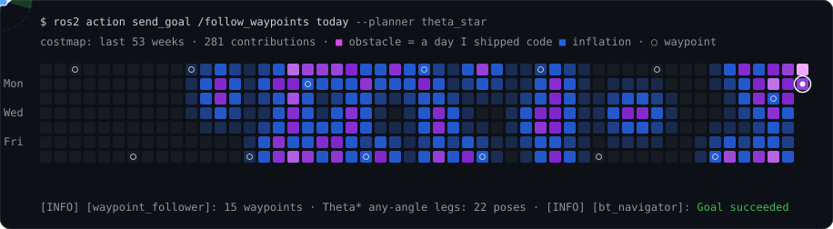

<!-- bringup.svg, costmap.svg and the RQT-GRAPH block are regenerated daily by .github/workflows/robot.yml;
     portrait.svg is built once from images/ with scripts/portrait.py -->
<p align="center">
  
</p>

<p align="center">
  <b>Shanmukha Vishnu</b> · Robotics Engineer · I turn bugs into features — upstream.<br/>
  <a href="https://www.linkedin.com/in/shanmukhavishnu/"></a>
  <a href="https://twitter.com/iam_shanmukha"></a>
  <a href="https://www.shanmukhavishnu.in"></a>
  <a href="https://www.instagram.com/shanmukhavishnu/"></a>
  <a href="https://www.reddit.com/user/iam_shanmukha"></a>
  <a href="https://wakatime.com/@d99e99d2-68be-42e0-bc5a-ac2324d7cd15"></a>
</p>

## 🛰️ `/contributions` — node graph

<!-- RQT-GRAPH:START -->
```console
$ ros2 run rqt_graph rqt_graph --headless

                                   ┌──────────────────────────────────┐
                              ┌───▶│ /navigation2           ×3 merged │  ⭐ 5.0k
                              │    └──────────────────────────────────┘  ◀ /behavior_trees /amcl /planners
                              │    ┌──────────────────────────────────┐
                              ├───▶│ /docsgpt               ×1 merged │  ⭐ 18.4k
                              │    └──────────────────────────────────┘  ◀ /rag /text_to_speech
┌────────────────────────┐    │    ┌──────────────────────────────────┐
│ /shanmukha_vishnu      │────┼───▶│ /kestra                ×3 merged │  ⭐ 30.1k
│ [robotics_engineer]    │    │    └──────────────────────────────────┘  ◀ /airbyte /flink
└────────────────────────┘    │    ┌──────────────────────────────────┐
                              ├───▶│ /ros_ecosystem         ×2 merged │  ⭐ 1.1k
                              │    └──────────────────────────────────┘  ◀ /depthai_driver /rosdep
                              │    ┌──────────────────────────────────┐
                              └───▶│ /xonsh                 ×1 merged │  ⭐ 9.7k
                                   └──────────────────────────────────┘  ◀ /shell
```

<details>
<summary><code>$ ros2 topic echo /merged_prs</code> — 10 merged upstream (click)</summary>

**`/navigation2`** — the ROS 2 Navigation Stack · ⭐ 5.0k

- ✅ [navigation2#6725](https://github.com/ros-navigation/navigation2/pull/6725) — fix: reject non-positive Theta* terminal_checking_interval
- ✅ [navigation2#6724](https://github.com/ros-navigation/navigation2/pull/6724) — fix: allow negative laser_min_range/laser_max_range in AMCL dynamic parameters
- ✅ [navigation2#6723](https://github.com/ros-navigation/navigation2/pull/6723) — fix: RoundRobin returns last child's SUCCESS when wrap_around is disabled
- 🟡 [navigation2#6729](https://github.com/ros-navigation/navigation2/pull/6729) — fix: apply BinaryFilter default_state on startup *(in review)*

**`/docsgpt`** — open-source RAG assistant · ⭐ 18.4k

- ✅ [DocsGPT#2956](https://github.com/arc53/DocsGPT/pull/2956) — fix: restore markdown cleanup before text-to-speech

**`/kestra`** — orchestration platform (Hacktoberfest 2026) · ⭐ 30.1k

- ✅ [plugin-flink#75](https://github.com/kestra-io/plugin-flink/pull/75) — fix(sql): close SubmitSql HTTP client and bound connectionTimeout
- ✅ [plugin-flink#71](https://github.com/kestra-io/plugin-flink/pull/71) — fix(sql): apply connectionTimeout to SubmitSql HTTP clients
- ✅ [plugin-airbyte#202](https://github.com/kestra-io/plugin-airbyte/pull/202) — fix(connections): render url in CheckStatus before polling

**`/ros_ecosystem`** — drivers & distro · ⭐ 1.1k

- ✅ [depthai-ros#667](https://github.com/luxonis/depthai-ros/pull/667) — fix : Ip autodiscovery fix noetic
- ✅ [rosdistro#41063](https://github.com/ros/rosdistro/pull/41063) — json-stream

**`/xonsh`** — Python-powered shell · ⭐ 9.7k

- ✅ [xonsh#4500](https://github.com/xonsh/xonsh/pull/4500) — Fix #4467

</details>
<!-- RQT-GRAPH:END -->

## 🗺️ `/costmap` — my year, as a robot sees it

<p align="center">
  
</p>

<sub>Every square is a day of my GitHub calendar turned into a Nav2-style costmap: the busier the day, the higher the cost, and my busiest days are lethal obstacles. Each morning a GitHub Action re-plans a <a href="https://github.com/ros-navigation/navigation2/tree/main/nav2_theta_star_planner">Theta*</a> path from my first day to today, and the robot drives it.</sub>

## 📡 `/scan` — me, as my robot sees me

<p align="center">
  
</p>

## ⚙️ `ros2 param dump /shanmukha_vishnu`

```yaml
shanmukha_vishnu:
  ros__parameters:
    education: Electrical Engineering
    role: Robotics Engineer                       # autonomous vehicles
    previously: Eruvaka Technologies              # embedded R&D + ROS (2020–2023)
    loves: [sensors, LiDAR, embedded electronics, autonomous robots & vehicles]
    languages: [C++, Python, C, Bash, JavaScript]
    stack: [ROS 2, Nav2, Linux, Raspberry Pi, Arduino, AWS, GCP]
    hobbies: [dholak, piano, writing quotes]
    open_source_contributor: by_night
```

<details>
<summary><code>$ ros2 topic echo /quote</code></summary>

> People who stay single are already committed to their Passion.
>
> The Passion that keeps them occupied.
>
> The Passion that makes them enjoyed.
>
> -- Shanmukha Vishnu

More on [YourQuote](https://www.yourquote.in/shanmukha-vishnu-bp7sd/quotes).
</details>

<details>
<summary><code>$ ros2 topic echo /publications</code></summary>

- [Gleaming of Lights by Pedaling using Arduino](https://link.springer.com/chapter/10.1007/978-981-15-9853-1_30) — Springer
- [Cybernation of Home Appliances using Raspberry Pi](https://www.ieindia.org/webui/ajax/Downloads/WebUI_PDF/IEC/IEC_35.pdf?v20210205.1) — IEI
- [QR code based digital assistant for seminar halls using Tinker Board and Node-Red](https://link.springer.com/book/10.1007%2F978-981-16-2109-3) — Springer
</details>

<details>
<summary><code>$ ros2 pkg list --mine</code></summary>

- **Drushya** — CRT TV → Smart TV with Google Assistant
- [**Covid Bot India**](https://github.com/iam-shanmukha/corona_data.py) — [Twitter](https://twitter.com/covid_bot_India) · [Telegram](https://t.me/covid_bot_india)
- **D.A.S.H** — Digital Assistant for Seminar Halls
</details>

<details>
<summary><code>$ ros2 topic echo /currently_reading</code></summary>

<!-- GOODREADS-LIST:START -->
- [Ghost in the Wires: My Adventures as the World's Most Wanted Hacker](https://www.goodreads.com/review/show/4950146496?utm_medium=api&utm_source=rss) by Kevin D. Mitnick (⭐️3.91)
- [The Lean Startup: How Today's Entrepreneurs Use Continuous Innovation to Create Radically Successful Businesses](https://www.goodreads.com/review/show/4869075249?utm_medium=api&utm_source=rss) by Eric Ries (⭐️4.11)
<!-- GOODREADS-LIST:END -->
</details>
